# Календарь звонков (продолжение)

[](https://github.com/andreykolomensky-prog/ai-for-developers-project-387/actions)
[](https://github.com/andreykolomensky-prog/ai-for-developers-project-387/actions/workflows/ci.yml)

<p align="center">
  <picture>
    <source media="(prefers-color-scheme: dark)" srcset="docs/story/01-hero.dark.png">
    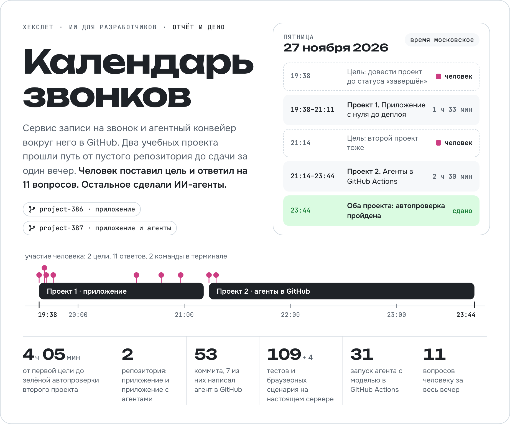
  </picture>
</p>

Сервис записи на звонок и процесс его разработки в GitHub, где часть работы выполняют ИИ-агенты: разбор обращений, реализация по согласованной спецификации, ревью pull request и регулярный аудит.

Этот README построен как отчёт и демо в картинках. Он отвечает на три вопроса: что это за проект, что сделано и как. Человек поставил цель и ответил на 11 вопросов об окружении и доступах, остальное сделали два агента: Claude Code на машине владельца и OpenCode в GitHub Actions. Все числа взяты из истории Git и GitHub Actions на 23:44 МСК 27 ноября 2026 года.

Учебный проект Хекслета: https://ru.hexlet.io/programs/ai-for-developers

| Что нужно          | Куда идти                                                                                               |
| ------------------ | ------------------------------------------------------------------------------------------------------- |
| Открыть приложение | https://ai-for-developers-project-386-piq5.onrender.com (первый запрос после паузы идёт до минуты)      |
| Запустить у себя   | `docker build -t call-calendar . && docker run --rm -p 8080:8080 -e PORT=8080 call-calendar`            |
| Позвать агента     | комментарий с `/oc` или `/opencode` в issue или pull request                                            |
| Проверить всё      | `mise run check`                                                                                        |
| Первый проект      | [ai-for-developers-project-386](https://github.com/andreykolomensky-prog/ai-for-developers-project-386) |

**Содержание**

- Общая картина: [Карта: два проекта, два репозитория](#карта-два-проекта-два-репозитория) · [Хроника вечера](#хроника-вечера) · [Кто что делал](#кто-что-делал)
- [Часть 1. Приложение с нуля до публичной ссылки](#часть-1-приложение-с-нуля-до-публичной-ссылки): [Демо](#демо) · [Правила записи](#правила-записи) · [Архитектура](#архитектура) · [Проектирование](#проектирование) · [Проверки](#проверки)
- [Часть 2. Агент переезжает в GitHub](#часть-2-агент-переезжает-в-github): [Шесть воркфлоу](#шесть-воркфлоу) · [Один цикл доработки](#один-цикл-доработки) · [Pull request агента](#pull-request-агента) · [Предохранители](#предохранители) · [Независимое ревью](#независимое-ревью) · [Ежедневный аудит](#ежедневный-аудит)
- [Часть 3. Итоги](#часть-3-итоги): [Числа](#числа) · [Грабли](#грабли) · [Дорожная карта](#дорожная-карта)
- [Короткие ответы](#короткие-ответы) · [Как открыть приложение](#как-открыть-приложение) · [Справочник](#справочник)

## Карта: два проекта, два репозитория

<p align="center">
  <picture>
    <source media="(prefers-color-scheme: dark)" srcset="docs/story/02-map.dark.png">
    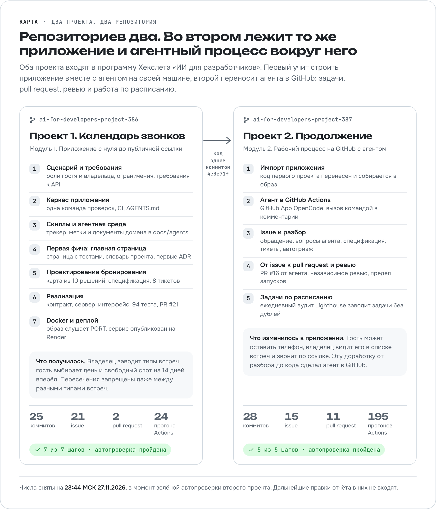
  </picture>
</p>

Репозиториев два. В [первом](https://github.com/andreykolomensky-prog/ai-for-developers-project-386) лежит приложение, во втором, то есть здесь, то же приложение и агентный процесс вокруг него. Код перенесён [одним коммитом](https://github.com/andreykolomensky-prog/ai-for-developers-project-387/commit/4e3e71f) с версии [`400138c`](https://github.com/andreykolomensky-prog/ai-for-developers-project-386/commit/400138c), дальше репозитории живут раздельно.

## Хроника вечера

<p align="center">
  <picture>
    <source media="(prefers-color-scheme: dark)" srcset="docs/story/03-timeline.dark.png">
    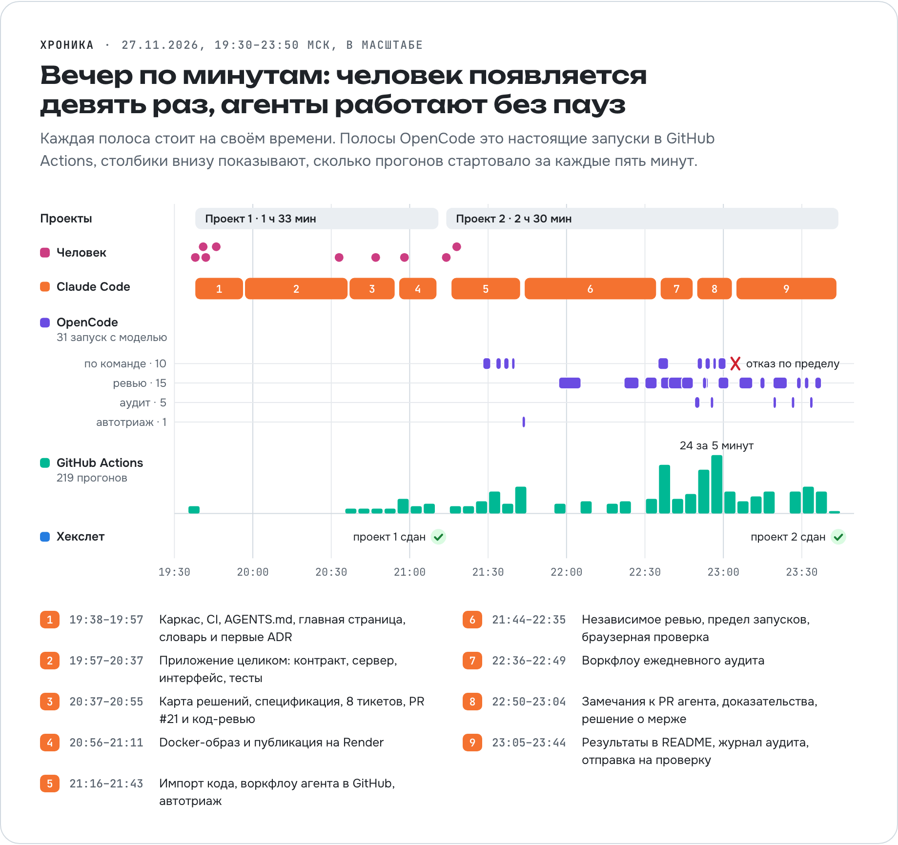
  </picture>
</p>

Полосы стоят на своём времени. Запуски агента и столбики прогонов взяты из истории Actions [этого](https://github.com/andreykolomensky-prog/ai-for-developers-project-387/actions) и [первого](https://github.com/andreykolomensky-prog/ai-for-developers-project-386/actions) репозитория.

## Кто что делал

<p align="center">
  <picture>
    <source media="(prefers-color-scheme: dark)" srcset="docs/story/04-roles.dark.png">
    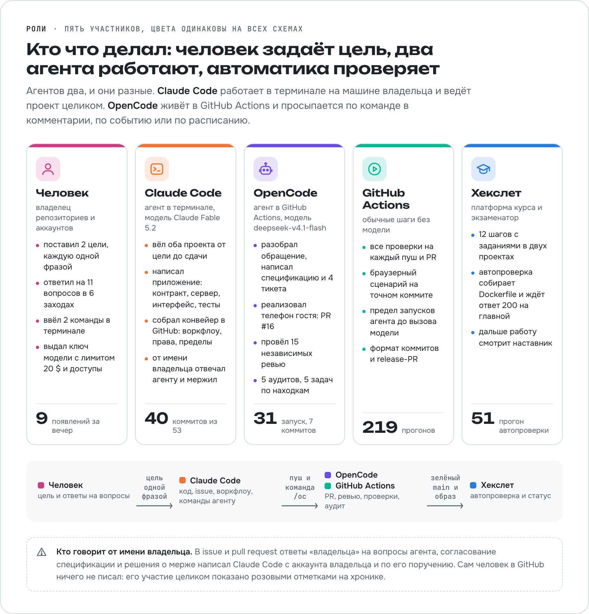
  </picture>
</p>

Агентов два, и они разные. **Claude Code** работает в терминале владельца и ведёт проект целиком. **[OpenCode](https://opencode.ai/docs/github/)** живёт в GitHub Actions и просыпается по команде в комментарии, по событию или по расписанию.

> [!NOTE]
> Реплики «владельца» в issue и pull request этого репозитория написал Claude Code с аккаунта владельца и по его поручению: ответы на вопросы разбора, согласование спецификации, решения о мерже. Сам человек отвечал только Claude Code.

## Часть 1. Приложение с нуля до публичной ссылки

Сервис записи на звонок по мотивам [Cal.com](https://cal.com). Его целиком написал Claude Code: контракт API, сервер, интерфейс, тесты, Docker-образ и публикацию. История решений лежит в [трекере первого репозитория](https://github.com/andreykolomensky-prog/ai-for-developers-project-386/issues?q=is%3Aissue).

### Демо

<p align="center">
  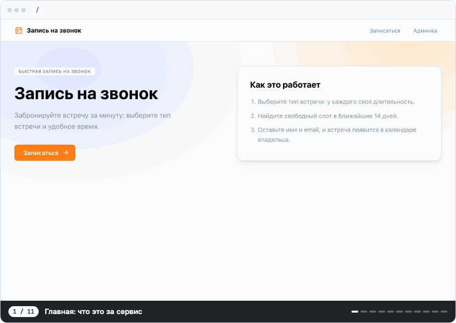
</p>

<p align="center">
  <picture>
    <source media="(prefers-color-scheme: dark)" srcset="docs/story/05-demo.dark.png">
    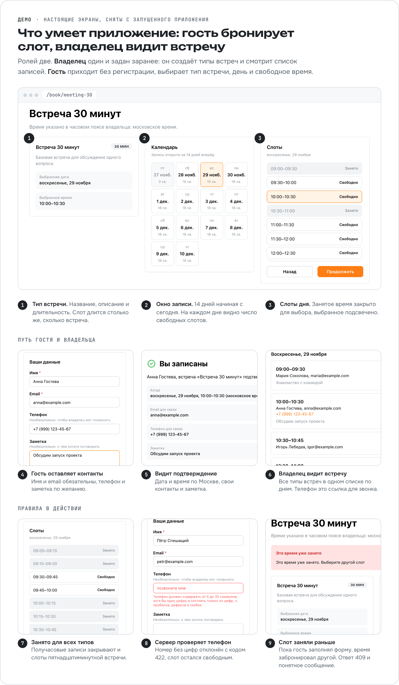
  </picture>
</p>

Экраны сняты с запущенного приложения этого репозитория. Тот же путь проходит браузерный сценарий [e2e/booking.spec.ts](e2e/booking.spec.ts). Опубликованный сервис: https://ai-for-developers-project-386-piq5.onrender.com

### Правила записи

<p align="center">
  <picture>
    <source media="(prefers-color-scheme: dark)" srcset="docs/story/06-rules.dark.png">
    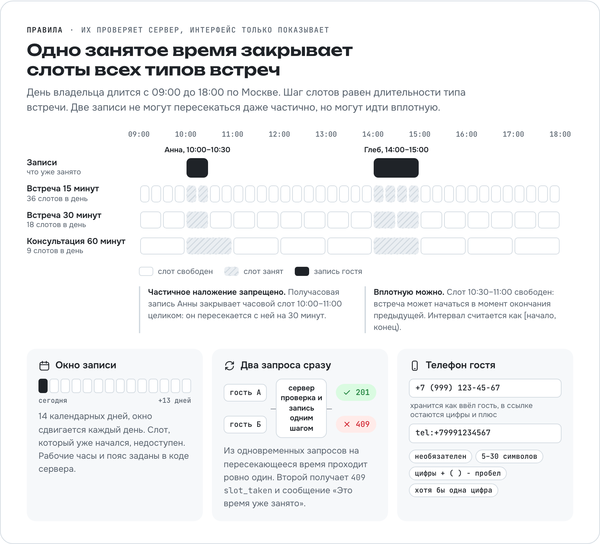
  </picture>
</p>

Правила проверяет сервер: [server/schedule.ts](server/schedule.ts) и [server/booking.ts](server/booking.ts). Термины в [GLOSSARY.md](GLOSSARY.md), решения в ADR [0004](docs/adr/0004-owner-schedule-is-fixed-in-moscow-time.md), [0005](docs/adr/0005-slot-grid-step-equals-event-type-duration.md) и [0006](docs/adr/0006-bookings-live-in-process-memory.md).

### Архитектура

<p align="center">
  <picture>
    <source media="(prefers-color-scheme: dark)" srcset="docs/story/07-architecture.dark.png">
    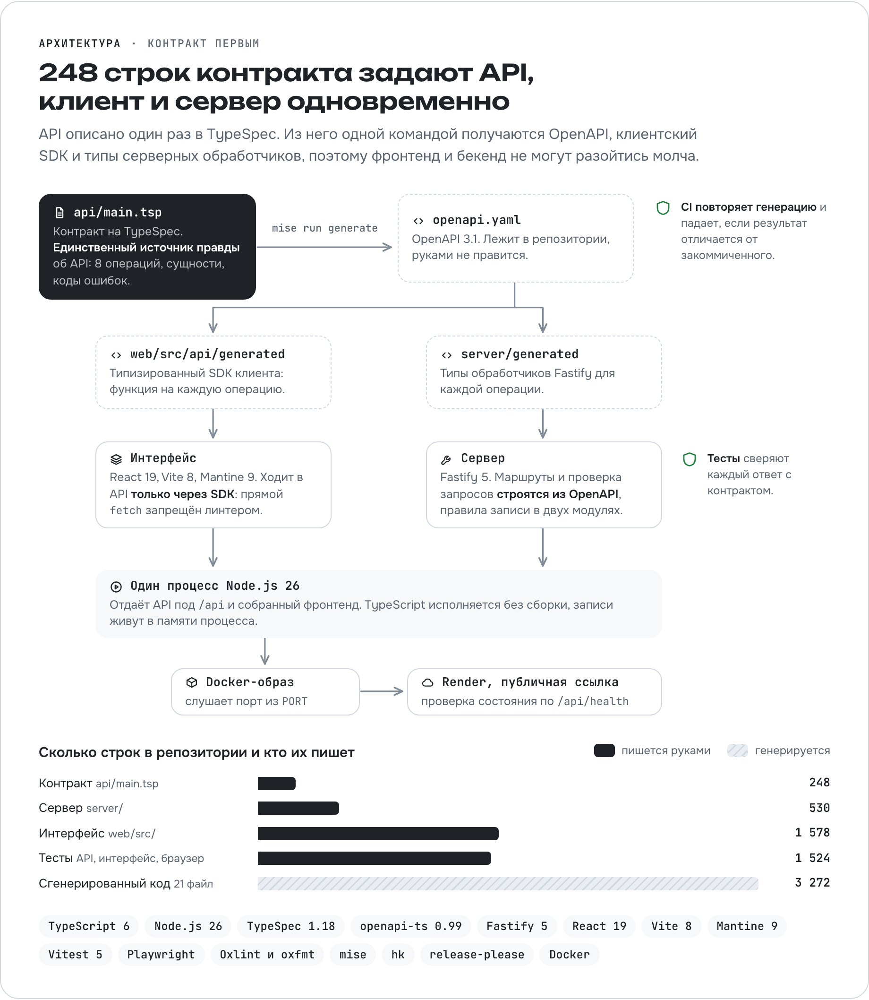
  </picture>
</p>

Контракт: [api/main.tsp](api/main.tsp). Результат генерации: [api/generated/openapi.yaml](api/generated/openapi.yaml), `web/src/api/generated`, `server/generated`. Решения: ADR [0001](docs/adr/0001-one-process-serves-api-and-frontend.md), [0002](docs/adr/0002-server-runs-typescript-without-build.md), [0007](docs/adr/0007-contract-first-with-committed-generated-code.md).

### Проектирование

<p align="center">
  <picture>
    <source media="(prefers-color-scheme: dark)" srcset="docs/story/08-decisions.dark.png">
    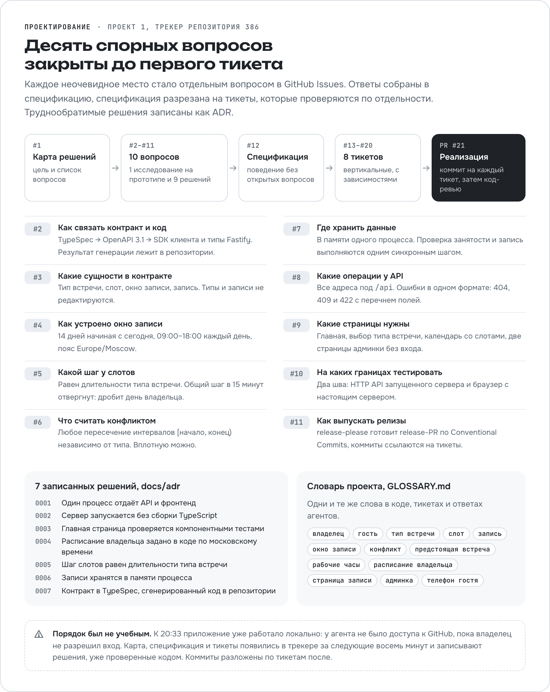
  </picture>
</p>

В трекере первого репозитория: [карта решений #1](https://github.com/andreykolomensky-prog/ai-for-developers-project-386/issues/1), вопросы [#2](https://github.com/andreykolomensky-prog/ai-for-developers-project-386/issues/2)–[#11](https://github.com/andreykolomensky-prog/ai-for-developers-project-386/issues/11), [спецификация #12](https://github.com/andreykolomensky-prog/ai-for-developers-project-386/issues/12), тикеты [#13](https://github.com/andreykolomensky-prog/ai-for-developers-project-386/issues/13)–[#20](https://github.com/andreykolomensky-prog/ai-for-developers-project-386/issues/20), [pull request #21](https://github.com/andreykolomensky-prog/ai-for-developers-project-386/pull/21). Решения: [docs/adr](docs/adr).

### Проверки

<p align="center">
  <picture>
    <source media="(prefers-color-scheme: dark)" srcset="docs/story/09-quality.dark.png">
    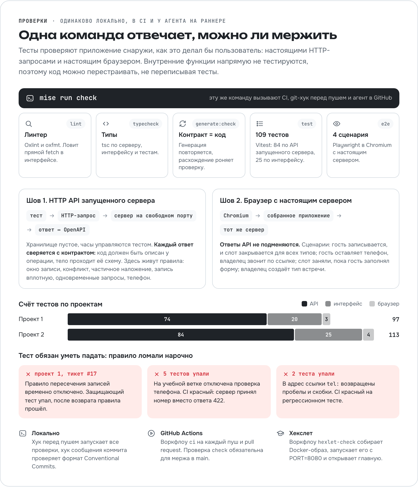
  </picture>
</p>

Задачи проверок в [mise.toml](mise.toml), тесты в [test](test), [web/src](web/src) и [e2e](e2e), git-хуки в [hk.pkl](hk.pkl). Красные прогоны на учебных ветках: [отключена проверка телефона](https://github.com/andreykolomensky-prog/ai-for-developers-project-387/actions/runs/46059869565), [возвращены пробелы в адрес ссылки](https://github.com/andreykolomensky-prog/ai-for-developers-project-387/actions/runs/46060123949). Проверка чувствительности теста в первом проекте: [тикет #17](https://github.com/andreykolomensky-prog/ai-for-developers-project-386/issues/17).

## Часть 2. Агент переезжает в GitHub

То же приложение, но работа над ним идёт через задачи и pull request. Агента зовут комментарием, его работу проверяют обычные шаги и отдельный ревьюер, а раз в сутки он сам ищет проблемы на опубликованной странице.

### Шесть воркфлоу

<p align="center">
  <picture>
    <source media="(prefers-color-scheme: dark)" srcset="docs/story/10-agent-system.dark.png">
    
  </picture>
</p>

Агент [OpenCode](https://opencode.ai/docs/github/) работает внутри GitHub Actions. На репозиторий установлено приложение [OpenCode Agent](https://github.com/apps/opencode-agent): от его имени агент пишет комментарии, создаёт ветки и pull request. Ключ модели лежит в секрете репозитория `OPENCODE_API_KEY`, в файлах его нет.

Команды вызова (`mentions`): `/oc` и `/opencode`.

OpenCode ставится на раннер зафиксированной версией из npm (`.github/actions/setup-opencode`), затем воркфлоу выполняет `opencode github run`. Это та же команда, которую запускает готовый action `anomalyco/opencode/github`. Отличие в установке: готовый action узнаёт версию анонимным запросом к GitHub API и падает, когда раннер упирается в лимит запросов, так и случилось в первом же прогоне.

| Воркфлоу                                                       | Событие                                                                                                                                  | Модель                         | Назначение                                                                                                                                    | Где смотреть результат                                                                                                   |
| -------------------------------------------------------------- | ---------------------------------------------------------------------------------------------------------------------------------------- | ------------------------------ | --------------------------------------------------------------------------------------------------------------------------------------------- | ------------------------------------------------------------------------------------------------------------------------ |
| [opencode.yml](.github/workflows/opencode.yml)                 | Новый комментарий к issue, к pull request (`issue_comment`) или к строке diff (`pull_request_review_comment`), только `types: [created]` | `opencode/deepseek-v4.1-flash` | Интерактивный агент: объясняет issue, разбирает обращение, запускает скиллы `to-spec`, `to-tickets`, `implement-spec`, правит PR по замечанию | Ответ приходит комментарием в том же issue или PR, прогон во вкладке Actions → opencode                                  |
| [opencode-triage.yml](.github/workflows/opencode-triage.yml)   | Новое обращение (`issues`, `types: [opened]`)                                                                                            | `opencode/deepseek-v4.1-flash` | Автотриаж: что приложение уже умеет, категория, вопросы автору, метки состояния. Инструкция задана в `prompt`                                 | Комментарий агента и метки в самом issue, прогон во вкладке Actions → opencode-triage                                    |
| [opencode-review.yml](.github/workflows/opencode-review.yml)   | Открытие и обновление pull request (`pull_request`)                                                                                      | `opencode/deepseek-v4.1-flash` | Независимое авторевью по критериям из [REVIEW.md](REVIEW.md): сверяет diff со спецификацией и результатами CI, код не правит                  | Комментарий «Независимое ревью» в PR, текст сохраняется артефактом `review`, прогон во вкладке Actions → opencode-review |
| [pr-browser-check.yml](.github/workflows/pr-browser-check.yml) | Открытие и обновление pull request (`pull_request`)                                                                                      | без модели                     | Браузерная проверка работающей версии PR: сценарии Playwright на приложении, собранном из точного head SHA                                    | Артефакт `browser-check-<SHA>` с результатом, SHA и trace, сводка на странице прогона                                    |
| [pr-commits.yml](.github/workflows/pr-commits.yml)             | Открытие и обновление pull request (`pull_request`)                                                                                      | без модели                     | Проверяет, что все коммиты PR написаны по Conventional Commits. У агента на раннере git-хуки выключены, поэтому правило проверяется здесь     | Проверка `conventional` в PR                                                                                             |
| [opencode-audit.yml](.github/workflows/opencode-audit.yml)     | Расписание (`schedule`, раз в сутки в 06:17 по Москве) и ручной запуск (`workflow_dispatch`)                                             | `opencode/deepseek-v4.1-flash` | Регулярный аудит: Lighthouse проверяет опубликованное приложение, агент заводит задачу по каждой новой находке. Инструкция задана в `prompt`  | Артефакт `audit-report` с отчётом и выводом агента, вывод на странице прогона, задачи с меткой `audit`                   |

### Один цикл доработки

<p align="center">
  <picture>
    <source media="(prefers-color-scheme: dark)" srcset="docs/story/11-cycle.dark.png">
    
  </picture>
</p>

Всё по ссылкам: [обращение #4](https://github.com/andreykolomensky-prog/ai-for-developers-project-387/issues/4) с разбором, вопросами и [согласованием](https://github.com/andreykolomensky-prog/ai-for-developers-project-387/issues/4#issuecomment-7225765216), [спецификация #6](https://github.com/andreykolomensky-prog/ai-for-developers-project-387/issues/6), тикеты [#7](https://github.com/andreykolomensky-prog/ai-for-developers-project-387/issues/7), [#8](https://github.com/andreykolomensky-prog/ai-for-developers-project-387/issues/8), [#9](https://github.com/andreykolomensky-prog/ai-for-developers-project-387/issues/9), [#10](https://github.com/andreykolomensky-prog/ai-for-developers-project-387/issues/10), [pull request #16](https://github.com/andreykolomensky-prog/ai-for-developers-project-387/pull/16).

### Pull request агента

<p align="center">
  <picture>
    <source media="(prefers-color-scheme: dark)" srcset="docs/story/12-pull-request.dark.png">
    
  </picture>
</p>

Доказательства: [решение о мерже](https://github.com/andreykolomensky-prog/ai-for-developers-project-387/pull/16#issuecomment-7227140091), [браузерная проверка последнего коммита](https://github.com/andreykolomensky-prog/ai-for-developers-project-387/actions/runs/46060316643), [отказ по пределу](https://github.com/andreykolomensky-prog/ai-for-developers-project-387/actions/runs/46060798640), красные прогоны [раз](https://github.com/andreykolomensky-prog/ai-for-developers-project-387/actions/runs/46059869565) и [два](https://github.com/andreykolomensky-prog/ai-for-developers-project-387/actions/runs/46060123949).

### Предохранители

<p align="center">
  <picture>
    <source media="(prefers-color-scheme: dark)" srcset="docs/story/13-guards.dark.png">
    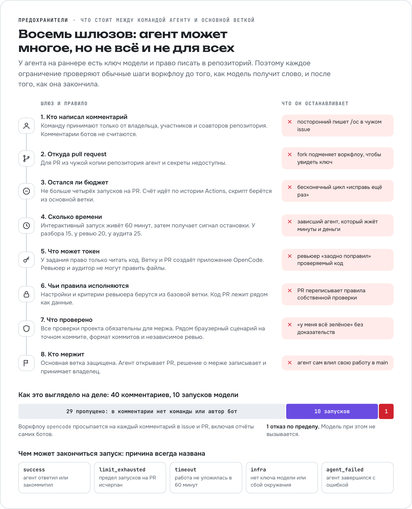
  </picture>
</p>

Где это записано: [opencode.yml](.github/workflows/opencode.yml), [pr-budget.sh](.github/scripts/pr-budget.sh), [opencode.json](opencode.json), раздел «Работа в GitHub Actions» в [AGENTS.md](AGENTS.md). Подробности текстом в [Справочник](#справочник).

### Независимое ревью

<p align="center">
  <picture>
    <source media="(prefers-color-scheme: dark)" srcset="docs/story/14-review.dark.png">
    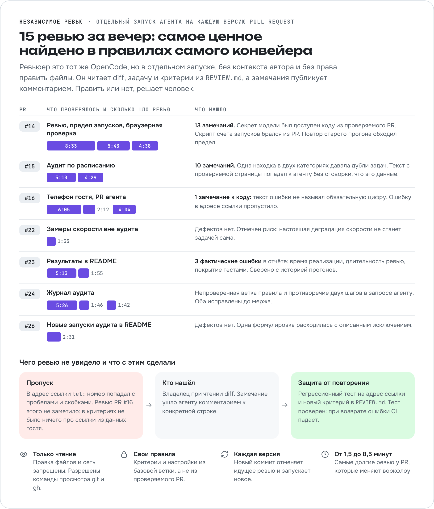
  </picture>
</p>

Критерии ревью: [REVIEW.md](REVIEW.md). Воркфлоу: [opencode-review.yml](.github/workflows/opencode-review.yml). Самые содержательные ревью в обсуждениях [#14](https://github.com/andreykolomensky-prog/ai-for-developers-project-387/pull/14), [#15](https://github.com/andreykolomensky-prog/ai-for-developers-project-387/pull/15) и [#23](https://github.com/andreykolomensky-prog/ai-for-developers-project-387/pull/23).

### Ежедневный аудит

<p align="center">
  <picture>
    <source media="(prefers-color-scheme: dark)" srcset="docs/story/15-audit.dark.png">
    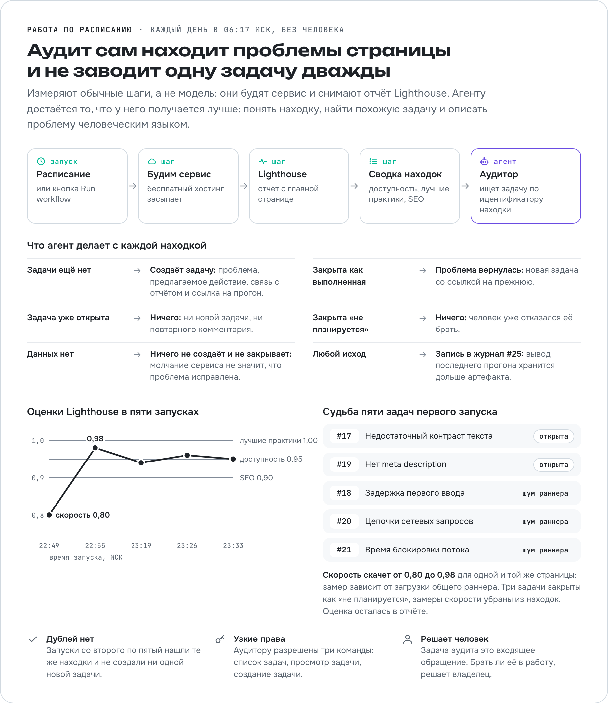
  </picture>
</p>

Воркфлоу: [opencode-audit.yml](.github/workflows/opencode-audit.yml). Задачи аудита: [#17](https://github.com/andreykolomensky-prog/ai-for-developers-project-387/issues/17), [#18](https://github.com/andreykolomensky-prog/ai-for-developers-project-387/issues/18), [#19](https://github.com/andreykolomensky-prog/ai-for-developers-project-387/issues/19), [#20](https://github.com/andreykolomensky-prog/ai-for-developers-project-387/issues/20), [#21](https://github.com/andreykolomensky-prog/ai-for-developers-project-387/issues/21). Журнал: [#25](https://github.com/andreykolomensky-prog/ai-for-developers-project-387/issues/25). Запуски: [первый](https://github.com/andreykolomensky-prog/ai-for-developers-project-387/actions/runs/46059391371), [второй](https://github.com/andreykolomensky-prog/ai-for-developers-project-387/actions/runs/46060064542), [с журналом](https://github.com/andreykolomensky-prog/ai-for-developers-project-387/actions/runs/46062812220), [учебный](https://github.com/andreykolomensky-prog/ai-for-developers-project-387/actions/runs/46063615287), [третий из main](https://github.com/andreykolomensky-prog/ai-for-developers-project-387/actions/runs/46064454307).

## Часть 3. Итоги

### Числа

<p align="center">
  <picture>
    <source media="(prefers-color-scheme: dark)" srcset="docs/story/16-numbers.dark.png">
    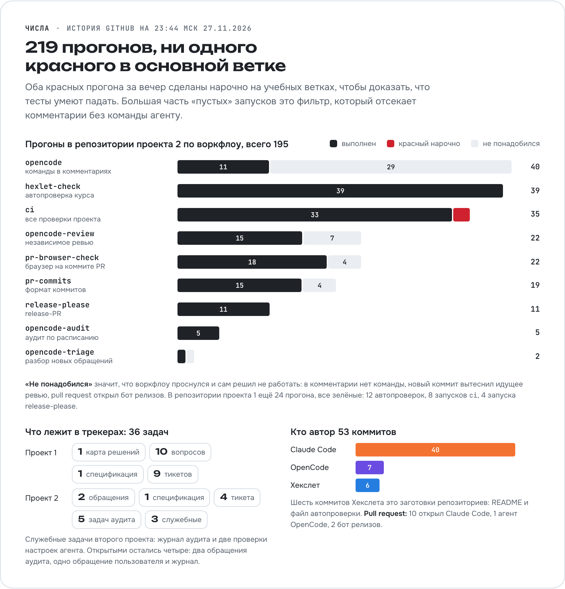
  </picture>
</p>

### Грабли

<p align="center">
  <picture>
    <source media="(prefers-color-scheme: dark)" srcset="docs/story/17-lessons.dark.png">
    
  </picture>
</p>

Те же выводы текстом, с подробностями о настройках и запросах агенту, лежат в справочнике: «Выводы о работе агента».

### Дорожная карта

<p align="center">
  <picture>
    <source media="(prefers-color-scheme: dark)" srcset="docs/story/18-roadmap.dark.png">
    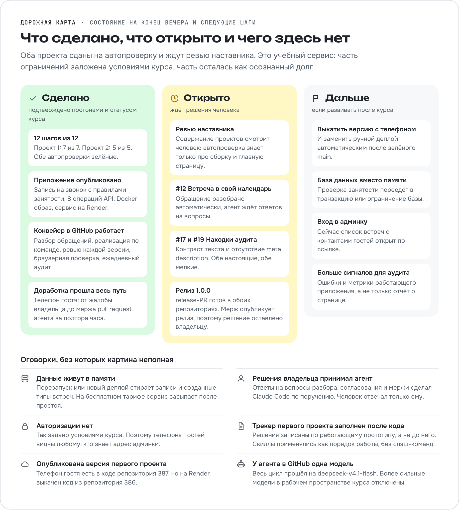
  </picture>
</p>

Открыто сейчас: [#12](https://github.com/andreykolomensky-prog/ai-for-developers-project-387/issues/12), [#17](https://github.com/andreykolomensky-prog/ai-for-developers-project-387/issues/17), [#19](https://github.com/andreykolomensky-prog/ai-for-developers-project-387/issues/19), release-PR [этого](https://github.com/andreykolomensky-prog/ai-for-developers-project-387/pull/5) и [первого](https://github.com/andreykolomensky-prog/ai-for-developers-project-386/pull/22) репозитория.

## Короткие ответы

<details>
<summary>Это один репозиторий или два?</summary>

Два. В [ai-for-developers-project-386](https://github.com/andreykolomensky-prog/ai-for-developers-project-386) лежит приложение первого проекта. Здесь лежит то же приложение и агентный процесс второго проекта: код перенесён одним коммитом, дальше репозитории живут раздельно.

</details>

<details>
<summary>Что делает приложение?</summary>

Владелец календаря заводит типы встреч с длительностью. Гость без регистрации выбирает тип, день из ближайших 14 и свободный слот, оставляет имя, email и по желанию телефон. Занятое время закрывается для всех типов встреч, владелец видит записи одним списком.

</details>

<details>
<summary>Кто писал код?</summary>

Приложение первого проекта, воркфлоу и документацию второго написал Claude Code. Доработку «телефон гостя» во втором проекте от разбора до кода сделал OpenCode в GitHub Actions: 7 коммитов из 53.

</details>

<details>
<summary>Что делал человек?</summary>

Поставил две цели, каждую одной фразой, ответил на 11 вопросов и ввёл 2 команды в терминале. Вопросы были о доступах и окружении: как установить GitHub CLI и mise, как войти в GitHub и Render, кто установит скиллы, можно ли менять настройки репозитория, где взять ключ модели. Решения по продукту и коду человек не принимал.

</details>

<details>
<summary>Сколько это заняло?</summary>

4 часа 05 минут от первой цели до зелёной автопроверки второго проекта: 1 час 33 минуты на первый проект и 2 часа 30 минут на второй.

</details>

<details>
<summary>Какие модели работали?</summary>

Claude Code работал на Claude Fable 5.2. Агент OpenCode в GitHub работал на `opencode/deepseek-v4.1-flash` с ключа рабочего пространства курса с лимитом 20 долларов. Фактический расход в отчёт не входит: он виден в консоли OpenCode.

</details>

<details>
<summary>Как позвать агента в GitHub?</summary>

Написать комментарий с командой `/oc` или `/opencode` в issue, в pull request или к строке diff. Команду принимают только от владельца и соавторов репозитория. В issue агент создаст ветку и откроет pull request, в pull request закоммитит в его ветку.

</details>

<details>
<summary>Может ли агент сам влить код в основную ветку?</summary>

Нет. Агент открывает pull request. Основная ветка защищена обязательной проверкой, а решение о мерже записывает и принимает владелец.

</details>

<details>
<summary>Что будет, если агент зациклится или зависнет?</summary>

На один pull request разрешено четыре запуска, пятый отклоняется до вызова модели. Один запуск живёт не дольше 60 минут. В обоих случаях в обсуждении появляется комментарий с причиной и ссылкой на логи.

</details>

<details>
<summary>Зачем ревью, если его делает тот же агент?</summary>

Это отдельный запуск без контекста автора и без права править файлы, с критериями из базовой ветки. Он нашёл серьёзные ошибки в правилах самого конвейера, включая доступ проверяемого кода к ключу модели. Человека он не заменяет: ошибку в адресе ссылки для звонка ревью пропустило.

</details>

<details>
<summary>Где хранятся данные и можно ли этим пользоваться всерьёз?</summary>

Записи живут в памяти процесса и пропадают при перезапуске, входа в админку нет. Это условия учебного проекта. Для настоящей работы нужны база данных и авторизация, обе стоят в дорожной карте.

</details>

<details>
<summary>Что осталось сделать?</summary>

Дождаться ревью наставника. Решить судьбу трёх открытых задач: обращения про добавление встречи в свой календарь и двух находок аудита. Влить или закрыть release-PR версии 1.0.0 в обоих репозиториях.

</details>

<details>
<summary>Как сделаны картинки?</summary>

Каждая картинка это снимок одной «плиты» страницы [docs/story/src/story.html](docs/story/src/story.html) в светлой и тёмной теме. Как их пересобрать, описано в [docs/story/README.md](docs/story/README.md).

</details>

## Как открыть приложение

Работающий адрес: **https://ai-for-developers-project-386-piq5.onrender.com**

Это сервис на бесплатном тарифе Render, развёрнутый из первого проекта. После 15 минут без запросов он засыпает, поэтому первый запрос может отвечать до минуты. Изменения этого репозитория на него не выкатываются автоматически.

Локальный запуск той же версии, что лежит в репозитории:

````bash
docker build -t call-calendar .
docker run --rm -p 8080:8080 -e PORT=8080 call-calendar

## Справочник

Подробности текстом. Здесь то же, что на схемах, но с командами, путями и ссылками на каждый прогон.

<details>
<summary>Откуда взят код</summary>

Приложение перенесено из первого проекта [ai-for-developers-project-386](https://github.com/andreykolomensky-prog/ai-for-developers-project-386), версия [`400138c`](https://github.com/andreykolomensky-prog/ai-for-developers-project-386/commit/400138cb4cb56003a1286ae78a1c603096dc9b83). Вместе с кодом перенесены `Dockerfile`, тесты, линтеры, воркфлоу, `AGENTS.md`, скиллы и их настройки в `docs/agents/`, словарь и записи решений.

Исходные решения остаются в трекере первого проекта: [карта решений](https://github.com/andreykolomensky-prog/ai-for-developers-project-386/issues/1), [спецификация приложения](https://github.com/andreykolomensky-prog/ai-for-developers-project-386/issues/12) и [pull request реализации](https://github.com/andreykolomensky-prog/ai-for-developers-project-386/pull/21). Новые задачи ведутся в Issues этого репозитория.

</details>

<details>
<summary>Агенты в GitHub: автотриаж и ограничения интерактивного агента</summary>

Автотриаж разбирает только обращения владельца, участников и соавторов репозитория, сообщения ботов пропускаются. Спецификации и тикеты, опубликованные скиллами `to-spec` и `to-tickets`, несут метку `ready-for-agent` и повторно не разбираются. У задания тайм-аут 15 минут, для одного issue работает один запуск. Код автотриаж не меняет.

Ограничения интерактивного агента:

- Модель вызывается только по команде в тексте комментария. Команду принимаем от владельца, участника или соавтора репозитория, сообщения ботов игнорируются.
- Pull request из fork агент не обслуживает: секрет модели для них не используется.
- Права задания с агентом: `contents: read`, `id-token: write` для токена приложения, `issues: write` для публикации спецификаций и тикетов через `gh`. Checkout выполняется с `persist-credentials: false`.
- Агент останавливается через 60 минут, у задания тайм-аут 70 минут: запас нужен, чтобы задание успело записать причину остановки. Для одного issue или PR одновременно работает один запуск.
- Агенту запрещены обращения к файлам вне репозитория (`opencode.json`).

</details>

<details>
<summary>Предел запусков на pull request</summary>

В одном pull request агента можно позвать не больше 4 раз. Предел проверяет отдельное задание `budget` до вызова модели и без секрета модели.

- Считается каждый допущенный запуск по команде человека в этом PR: и на общий комментарий, и на комментарий к строке diff. Повтор через Re-run, отмена и тайм-аут агента тоже расходуют попытку. Запуск, который GitHub отменил в очереди до проверки, не считается.
- Счётчик берётся из истории GitHub Actions: запуски воркфлоу `opencode` с номером этого PR в названии, в которых успешно отработало задание `budget`. Токен агента историю запусков изменить не может, текст комментариев на бюджет не влияет.
- Когда бюджет исчерпан, модель не вызывается. Задание `report` публикует в PR причину `limit_exhausted`, последний SHA и ссылку на логи со статусом «нужен человек».
- Тем же способом сообщаются остальные остановки: `timeout`, если агент не уложился во время, `infra`, если не удалось проверить бюджет, не подготовились инструменты или не задан ключ, и `agent_failed` при ошибке агента.
- Новый pull request получает новый бюджет. Команды в issue предел не расходуют. Администратор репозитория может изменить предел в `opencode.yml` или удалить историю запусков.

</details>

<details>
<summary>Авторевью и браузерная проверка</summary>

- Авторевью получает каждый pull request из ветки этого репозитория от доверенного участника или от агента OpenCode. PR из fork секрет модели не получают, release-PR не ревьюится.
- Ревьюер запускается обычным CLI `opencode run` с агентом `reviewer` из `opencode.json`: запись файлов ему запрещена, из команд оболочки разрешено только чтение через `git` и `gh`. Токен задания только читает: код, issue, результаты CI.
- Установка OpenCode, права ревьюера и критерии из `REVIEW.md` берутся из базовой ветки, а проверяемая версия лежит рядом в каталоге `pr/` как данные для чтения. Так PR не может ослабить собственное ревью. Остаётся ограничение GitHub: сам файл воркфлоу на событии `pull_request` выполняется из версии PR, поэтому правки в `.github/workflows/` всегда требуют решения человека.
- Текст ревью публикует отдельное задание без модели, только у него есть право писать в PR. Ревью устаревшей версии PR отменяется при новом коммите, тайм-аут 20 минут.
- Комментарий ревью сам исправление не запускает. Замечание передаёт автору человек командой `/oc`.
- Браузерная проверка собирает приложение из `github.event.pull_request.head.sha`, записывает результат `git rev-parse HEAD` и проходит сценарии Playwright с настоящим сервером. Trace включён и для успешных сценариев. Перед мержем человек сверяет SHA артефакта с текущим head PR.

</details>

<details>
<summary>Регулярный аудит</summary>

- Обычные шаги воркфлоу будят сервис по адресу из переменной репозитория `APP_URL`, снимают отчёт Lighthouse и выделяют из него находки: проваленные проверки доступности, лучших практик и SEO. Замеры скорости в находки не попадают: на общем раннере GitHub они зависят от его загрузки, а не от приложения. Оценка скорости остаётся в отчёте для справки.
- Отчёт, сводка находок и вывод агента сохраняются артефактом `audit-report` на 30 дней. Каталог `audit-report/` исключён из Git, в коммиты отчёты не попадают. Вывод агента дополнительно виден на странице прогона.
- Артефакт и страница прогона хранятся ограниченное время, поэтому вывод последнего прогона записывается в [задачу-журнал с меткой `audit-log`](https://github.com/andreykolomensky-prog/ai-for-developers-project-387/issues?q=label%3Aaudit-log). Её текст заменяется в конце каждого прогона, прежние версии остаются в истории правок. Журнал записывается и тогда, когда данных нет или один из шагов упал. Если прогон отменён или остановлен по тайм-ауту, в журнале остаётся прошлая запись, ссылка в ней показывает, к какому прогону она относится. Сбой записи в журнал делает прогон красным, поэтому устаревший журнал не останется незамеченным.
- Агент `auditor` из `opencode.json` не может менять файлы, из команд ему разрешены только `gh issue list`, `gh issue view` и `gh issue create`. Права задания: `contents: read` и `issues: write`.
- По каждой новой находке агент создаёт отдельную задачу с метками `audit` и `needs-triage`: проблема, предлагаемое действие, связь с отчётом. Последняя строка задачи хранит идентификатор находки, например `lighthouse/color-contrast`.
- Перед созданием агент ищет задачу с тем же идентификатором. Если открытая задача уже есть, новая не создаётся и комментарий не добавляется. Если человек закрыл задачу как «не планируется» или как дубликат, находка заново не заводится. Если задача закрыта как выполненная, а проблема появилась снова, создаётся новая со ссылкой на прежнюю.
- Если приложение не ответило или Lighthouse не смог снять отчёт, аудит записывает «данных нет» и задач не создаёт: отсутствие данных не означает, что находка исправлена.
- Что нужно для запуска: переменная репозитория `APP_URL` с адресом приложения (Settings → Secrets and variables → Actions → Variables) и секрет `OPENCODE_API_KEY`. Метки `audit` и `audit-log` воркфлоу создаёт сам, если их нет.
- Задача аудита остаётся входящим обращением. Брать ли её в работу, решает человек, дальше идёт та же цепочка со спецификацией и тикетами.
- Тайм-аут задания 25 минут, аудиты не идут параллельно.

</details>

<details>
<summary>Результаты запусков: таблицы со ссылками</summary>

Одна доработка прошла весь путь от обращения пользователя до мержа. По ссылкам видно, что предложил агент, что согласовал человек и как изменение проверено.

| Этап                          | Что произошло                                                                                                       | Где смотреть                                                                                                                                                                                                                                                                                                                                                                                                                                        |
| ----------------------------- | ------------------------------------------------------------------------------------------------------------------- | --------------------------------------------------------------------------------------------------------------------------------------------------------------------------------------------------------------------------------------------------------------------------------------------------------------------------------------------------------------------------------------------------------------------------------------------------- |
| Подключение                   | Агент ответил на команду в issue: назвал трекер, скиллы и команду проверок                                          | [#2](https://github.com/andreykolomensky-prog/ai-for-developers-project-387/issues/2), [прогон](https://github.com/andreykolomensky-prog/ai-for-developers-project-387/actions/runs/46049793366)                                                                                                                                                                                                                                                    |
| Обращение и разбор            | Владелец попросил телефон гостя. Агент проверил приложение и задал шесть вопросов                                   | [#4](https://github.com/andreykolomensky-prog/ai-for-developers-project-387/issues/4)                                                                                                                                                                                                                                                                                                                                                               |
| Спецификация и тикеты         | Скиллы `to-spec` и `to-tickets` опубликовали спецификацию и четыре тикета с зависимостями                           | [#6](https://github.com/andreykolomensky-prog/ai-for-developers-project-387/issues/6), [#7](https://github.com/andreykolomensky-prog/ai-for-developers-project-387/issues/7), [#8](https://github.com/andreykolomensky-prog/ai-for-developers-project-387/issues/8), [#9](https://github.com/andreykolomensky-prog/ai-for-developers-project-387/issues/9), [#10](https://github.com/andreykolomensky-prog/ai-for-developers-project-387/issues/10) |
| Согласование                  | Человек подтвердил объём до реализации                                                                              | [комментарий в #4](https://github.com/andreykolomensky-prog/ai-for-developers-project-387/issues/4#issuecomment-7225765216)                                                                                                                                                                                                                                                                                                                         |
| Реализация                    | Скилл `implement-spec` выполнил тикеты четырьмя коммитами, OpenCode открыл pull request                             | [PR #16](https://github.com/andreykolomensky-prog/ai-for-developers-project-387/pull/16)                                                                                                                                                                                                                                                                                                                                                            |
| Ревью и правки                | Независимое ревью, общий комментарий и комментарий к строке diff. Агент внёс три правки в ту же ветку               | [обсуждение PR #16](https://github.com/andreykolomensky-prog/ai-for-developers-project-387/pull/16)                                                                                                                                                                                                                                                                                                                                                 |
| Отказ при сломанном поведении | На учебных ветках CI падает, если отключить проверку телефона или вернуть ошибку в адресе ссылки                    | [прогон 46059869565](https://github.com/andreykolomensky-prog/ai-for-developers-project-387/actions/runs/46059869565), [прогон 46060123949](https://github.com/andreykolomensky-prog/ai-for-developers-project-387/actions/runs/46060123949)                                                                                                                                                                                                        |
| Браузерная проверка           | Артефакт с результатом, trace и SHA последнего коммита PR                                                           | [прогон 46060316643](https://github.com/andreykolomensky-prog/ai-for-developers-project-387/actions/runs/46060316643)                                                                                                                                                                                                                                                                                                                               |
| Предел запусков               | Пятый вызов агента в PR отклонён до вызова модели с причиной `limit_exhausted`                                      | [прогон 46060798640](https://github.com/andreykolomensky-prog/ai-for-developers-project-387/actions/runs/46060798640)                                                                                                                                                                                                                                                                                                                               |
| Мерж и релиз                  | Человек записал решение и влил PR, release-please обновил release-PR                                                | [решение](https://github.com/andreykolomensky-prog/ai-for-developers-project-387/pull/16#issuecomment-7227140091), [PR #5](https://github.com/andreykolomensky-prog/ai-for-developers-project-387/pull/5)                                                                                                                                                                                                                                           |
| Автотриаж                     | Новое обращение #12 разобрано автоматически. Учебное issue #13 с меткой готового тикета пропущено без вызова модели | [#12](https://github.com/andreykolomensky-prog/ai-for-developers-project-387/issues/12) и [его прогон](https://github.com/andreykolomensky-prog/ai-for-developers-project-387/actions/runs/46051543685), [#13](https://github.com/andreykolomensky-prog/ai-for-developers-project-387/issues/13) и [пропущенный прогон](https://github.com/andreykolomensky-prog/ai-for-developers-project-387/actions/runs/46051546556)                            |

Регулярный аудит запускался вручную из основной ветки трижды. Ещё два запуска шли из веток: ими проверены изменения самого воркфлоу до мержа.

| Запуск                                                                                                                         | Что нашёл агент                                                                           | Результат                                                                                                                                                                                                                                                                                                                                                                                                                                                                  |
| ------------------------------------------------------------------------------------------------------------------------------ | ----------------------------------------------------------------------------------------- | -------------------------------------------------------------------------------------------------------------------------------------------------------------------------------------------------------------------------------------------------------------------------------------------------------------------------------------------------------------------------------------------------------------------------------------------------------------------------- |
| [Первый](https://github.com/andreykolomensky-prog/ai-for-developers-project-387/actions/runs/46059391371)                      | Пять находок: контраст текста, отсутствие meta description и три замера скорости          | Созданы задачи [#17](https://github.com/andreykolomensky-prog/ai-for-developers-project-387/issues/17), [#18](https://github.com/andreykolomensky-prog/ai-for-developers-project-387/issues/18), [#19](https://github.com/andreykolomensky-prog/ai-for-developers-project-387/issues/19), [#20](https://github.com/andreykolomensky-prog/ai-for-developers-project-387/issues/20), [#21](https://github.com/andreykolomensky-prog/ai-for-developers-project-387/issues/21) |
| [Второй](https://github.com/andreykolomensky-prog/ai-for-developers-project-387/actions/runs/46060064542)                      | Те же две находки по доступности и SEO                                                    | Новых задач нет: агент нашёл открытые #17 и #19                                                                                                                                                                                                                                                                                                                                                                                                                            |
| [Из ветки с журналом](https://github.com/andreykolomensky-prog/ai-for-developers-project-387/actions/runs/46062812220)         | Те же две находки                                                                         | Создана задача-журнал [#25](https://github.com/andreykolomensky-prog/ai-for-developers-project-387/issues/25) с выводом агента, новых задач нет                                                                                                                                                                                                                                                                                                                            |
| [Учебный, из удалённой ветки](https://github.com/andreykolomensky-prog/ai-for-developers-project-387/actions/runs/46063615287) | К сводке добавлена подготовленная находка, задача по которой закрыта как «не планируется» | Агент ответил «отклонена человеком в #21» и ничего не создал. Журнал в этом запуске был выключен                                                                                                                                                                                                                                                                                                                                                                           |
| [Третий из основной ветки](https://github.com/andreykolomensky-prog/ai-for-developers-project-387/actions/runs/46064454307)    | Те же две находки                                                                         | Журнал #25 обновлён, новых задач нет                                                                                                                                                                                                                                                                                                                                                                                                                                       |

Между запусками человек разобрал находки. Задачи #18, #20 и #21 закрыты без работы: оценка скорости на общем раннере была 0,80, а во втором запуске 0,98 для той же страницы, то есть замер зависел от раннера. После этого замеры скорости убраны из находок аудита. Задачи #17 и #19 остаются входящими обращениями.

Отчёт Lighthouse, сводка находок и вывод агента лежат в артефакте `audit-report` каждого прогона, вывод агента продублирован на странице прогона. Вывод последнего завершившегося прогона хранится в [задаче-журнале](https://github.com/andreykolomensky-prog/ai-for-developers-project-387/issues?q=label%3Aaudit-log).

</details>

<details>
<summary>Выводы о работе агента</summary>

Что агент сделал без уточнений:

- Разбор обращения. Агент сам нашёл в коде форму гостя, контракт и тесты, сослался на файлы и строки и задал вопросы с рекомендуемыми ответами. Отвечать на них было быстрее, чем формулировать требования с нуля.
- Спецификация и тикеты. `to-spec` собрал решения из переписки, `to-tickets` разложил их на четыре вертикальных тикета с зависимостями. Править текст не пришлось.
- Реализация. `implement-spec` выполнил четыре тикета примерно за четыре минуты от команды до открытого pull request: контракт, генерация, сервер, интерфейс, тесты и документация, по коммиту на тикет в нужном формате.
- Правки по замечаниям. Каждое замечание агент закрыл отдельным коммитом в той же ветке. К двум правкам кода он добавил тесты, третья правка меняет только критерии ревью.

Что потребовало уточнений и что изменено в настройках:

- Первый запуск упал до вызова модели ([первая попытка прогона](https://github.com/andreykolomensky-prog/ai-for-developers-project-387/actions/runs/46049793366/attempts/1)): готовый action узнаёт версию OpenCode анонимным запросом к GitHub API и получил отказ по лимиту. OpenCode теперь ставится зафиксированной версией из npm.
- На раннере некому отвечать на вопросы и подтверждать действия. В `AGENTS.md` записано, что вопросы задаются комментарием, а в командах прямо сказано «интервью не проводи, решения уже приняты».
- Скилл `implement-spec` рассчитан на отдельные ветки, worktree и создание PR командой `gh`. В GitHub ветку и PR создаёт сам OpenCode, поэтому в `AGENTS.md` добавлено правило работать в текущей ветке и не отправлять её самому. Без этого правила PR мог не открыться.
- Git-хуки на раннере пришлось выключить: служебный коммит OpenCode с произвольным текстом не прошёл бы проверку формата, и работа запуска пропала бы. Формат коммитов проверяет отдельный воркфлоу `pr-commits`.
- Агент срабатывает на команду в любом месте комментария. Обычная фраза с упоминанием команды вызвала лишний запуск. В комментариях человека команда теперь пишется только тогда, когда агента действительно зовут: каждый такой запуск расходует бюджет PR.
- Независимое ревью оказалось полезнее всего на изменениях самих воркфлоу. Оно нашло, что секрет модели был доступен конфигурации из проверяемого PR, что повтор старого запуска обходил предел и что скрипт бюджета мог выполняться из версии PR. Всё исправлено до мержа, конфигурация ревьюера берётся из базовой ветки.
- Ревью не заменяет человека. Ошибку в адресе ссылки `tel:` оно пропустило, её нашёл человек при чтении diff. Проблема закреплена тестом и новым критерием в `REVIEW.md`.
- В текст ревью попадала первая служебная фраза агента. Публикуется только часть ответа после строки «Ревью коммита».
- Аудит в первом запуске завёл три задачи по замерам скорости, которые зависели от раннера. Замеры убраны из находок, задачи закрыты с объяснением.
- Вывод прогона без новых находок оставался только в артефакте и на странице прогона, которые хранятся ограниченное время. Добавлена задача-журнал, её текст воркфлоу заменяет в конце каждого прогона.
- Агент не различал причину закрытия задачи и завёл бы заново находку, которую человек отклонил. В запрос добавлены причины закрытия: повторным появлением считается только задача, закрытая как выполненная. Правило проверено учебным запуском с подготовленной находкой.

Что осталось ограничением:

- Ревью одной версии PR занимало от полутора до восьми с половиной минут: от двух до шести минут на PR реализации и дольше всего на первом PR с воркфлоу. Каждая правка в PR стоит этого ожидания.
- Предел запусков и доверие к авторам держатся на настройках репозитория. Администратор может изменить воркфлоу или удалить историю запусков.
- Файл воркфлоу на событии `pull_request` выполняется из версии PR, поэтому любые правки в `.github/workflows/` читает человек.
- Модель `opencode/deepseek-v4.1-flash` справилась со всеми задачами проекта. Более сильные модели в рабочем пространстве курса отключены, на них цикл не проверялся.

Скиллы первого проекта лежат в репозитории в `.claude/skills/`, поэтому на чистом раннере агент видит тот же набор, что и локально. Настройки трекера берутся из `docs/agents/`, команды проекта из `AGENTS.md`.

</details>

<details>
<summary>Сценарий: что требовал курс от приложения</summary>

«Запись на звонок» — упрощённый сервис бронирования времени по мотивам [Cal.com](https://cal.com).
В приложении две роли: владелец календаря (один, задан заранее) и гость (без регистрации).

### Владелец

1. Открывает раздел «Админка».
2. Создаёт тип встречи: название, описание и длительность в минутах (например, «Встреча 15 минут», 15 мин).
3. Видит созданный тип в списке типов встреч; при необходимости заводит ещё один с другой длительностью.
4. В списке «Предстоящие встречи» видит записи гостей по всем типам, отсортированные по времени начала. Если гость оставил телефон, он показан отдельной строкой под именем и email ссылкой `tel:`, чтобы позвонить одним нажатием.

### Гость

1. Открывает главную страницу и нажимает «Записаться».
2. На странице записи выбирает тип встречи — на карточке видны название, описание и длительность.
3. В календаре на ближайшие 14 дней выбирает день; справа отображаются слоты этого дня со статусом «Свободно» или «Занято».
4. Выбирает свободный слот, указывает имя, email и по желанию телефон и заметку, подтверждает запись.
5. Видит подтверждение. Если телефон указан, он показан в подтверждении. Выбранное время становится занятым для всех типов встреч.

### Сквозной сценарий

Владелец создаёт тип «Встреча 30 минут» → гость выбирает этот тип, день и слот 10:00–10:30, оставляет имя, email
и при желании телефон → запись появляется в списке предстоящих встреч владельца, а телефон, если он указан,
виден отдельной строкой; интервал 10:00–10:30 больше нельзя занять ни этим, ни другим типом встречи
(в том числе частично: слот 10:15–10:30 типа «15 минут» тоже недоступен).

### Обязательные функции

- Типы встреч: название, описание, длительность. Создаёт владелец.
- Окно записи — 14 календарных дней, сдвигается с течением времени.
- Длительность слота равна длительности типа встречи.
- Пересечение записей запрещено, включая частичное наложение разных типов. Следующая встреча может начинаться в момент окончания предыдущей.
- Правило действует и для одновременных запросов: из двух конкурирующих бронирований успешным будет только одно.
- Список предстоящих встреч всех типов для владельца.

### Ограничения

- Нет авторизации, личных кабинетов, уведомлений и интеграций с внешними календарями.
- Владелец календаря один и задан заранее.

### Требования к API

- Контракт описывается в TypeSpec, из него генерируется OpenAPI-спецификация.
- Клиентский SDK для фронтенда генерируется из OpenAPI; вручную запросы к API не пишутся.
- Приложение собирается в Docker-образ и запускается в контейнере.

</details>

<details>
<summary>Стек</summary>

- TypeScript, Node.js 26
- Контракт: [TypeSpec](https://typespec.io/) → OpenAPI 3.1 → клиентский SDK и серверные типы через [openapi-ts](https://heyapi.dev/)
- Бекенд: [Fastify](https://fastify.dev/), маршруты и проверка запросов строятся из OpenAPI ([fastify-openapi-glue](https://github.com/seriousme/fastify-openapi-glue))
- Фронтенд: [React](https://react.dev/), [Vite](https://vite.dev/), [Mantine](https://mantine.dev/)
- Тесты: [Vitest](https://vitest.dev/) для API и компонентов, [Playwright](https://playwright.dev/) для браузерного сценария
- Линтер и форматирование: [Oxlint и oxfmt](https://oxc.rs/), проверка типов `tsc`
- Окружение и задачи: [mise](https://mise.jdx.dev/), git-хуки через [hk](https://hk.jdx.dev/)

</details>

<details>
<summary>Установка и использование</summary>

### Установка

Нужен только [mise](https://mise.jdx.dev/getting-started.html): версии Node.js и остальных инструментов записаны в `mise.toml`.

```bash
git clone https://github.com/andreykolomensky-prog/ai-for-developers-project-387.git
cd ai-for-developers-project-387
mise trust
mise install      # ставит инструменты и подключает git-хуки
mise run install  # ставит зависимости из package-lock.json
````

### Использование

```bash
mise run dev    # бекенд на http://localhost:3000, фронтенд на http://localhost:5173
mise run check  # все проверки; эту же команду запускает CI
mise run start  # сборка фронтенда и запуск как в продакшене на PORT (по умолчанию 3000)
```

Остальные задачи показывает `mise tasks`. Рабочие правила проекта для ИИ-агентов описаны в [AGENTS.md](AGENTS.md), словарь в [GLOSSARY.md](GLOSSARY.md), принятые решения в [docs/adr](docs/adr).

### Страницы

| Адрес                | Что на странице                                                         |
| -------------------- | ----------------------------------------------------------------------- |
| `/`                  | Главная страница: рассказ о сервисе и переход к записи                  |
| `/book`              | Страница записи: выбор типа встречи                                     |
| `/book/<id типа>`    | Календарь на 14 дней, слоты выбранного дня, форма гостя и подтверждение |
| `/admin`             | Админка владельца: предстоящие встречи всех типов                       |
| `/admin/event-types` | Админка владельца: типы встреч и форма создания                         |

### Правила записи

- Окно записи: 14 календарных дней, начиная с сегодняшнего дня по Москве.
- Рабочие часы владельца: 09:00–18:00 каждый день, часовой пояс `Europe/Moscow`. Интерфейс показывает московское время.
- Слот длится столько, сколько тип встречи. Слоты идут подряд от 09:00, шаг равен длительности типа.
- Две записи не могут пересекаться даже частично и даже для разных типов встреч. Встреча может начинаться в момент окончания предыдущей.
- Правила проверяет сервер: из одновременных запросов на пересекающееся время проходит один, остальные получают `409` и понятное сообщение.
- Телефон гостя необязателен. Если он заполнен, сервер принимает номер длиной 5–30 символов из цифр, `+`, пробелов, дефисов и скобок, и в нём должна быть хотя бы одна цифра. Номер хранится как ввёл гость, без нормализации, только без пробелов по краям.

</details>

<details>
<summary>Контракт API</summary>

Источник правды об API это [api/main.tsp](api/main.tsp). Одна команда пересобирает всю цепочку:

```bash
mise run generate
```

Она создаёт OpenAPI-спецификацию [api/generated/openapi.yaml](api/generated/openapi.yaml), клиентский SDK `web/src/api/generated` и типы обработчиков Fastify `server/generated`. Эти каталоги лежат в репозитории и руками не правятся: `mise run check` повторяет генерацию и падает, если результат отличается от закоммиченного.

В запросе `POST /api/bookings` и в записи `Booking` есть необязательное поле `guestPhone`. Если гость не указал телефон, поля в ответе нет: без `null` и без пустой строки.

| Метод и адрес                              | Назначение                                                   | Ответы                                                              |
| ------------------------------------------ | ------------------------------------------------------------ | ------------------------------------------------------------------- |
| `GET /api/event-types`                     | Список типов встреч                                          | `200`                                                               |
| `POST /api/event-types`                    | Владелец создаёт тип встречи                                 | `201`, `409` идентификатор занят, `422` ошибка данных               |
| `GET /api/event-types/{id}`                | Один тип встречи                                             | `200`, `404`                                                        |
| `GET /api/event-types/{id}/booking-window` | Окно записи: слоты на 14 дней с отметкой занятости           | `200`, `404`                                                        |
| `GET /api/bookings`                        | Предстоящие встречи всех типов                               | `200`                                                               |
| `POST /api/bookings`                       | Гость создаёт запись                                         | `201`, `404` тип не найден, `409` время занято, `422` ошибка данных |
| `GET /api/schedule`                        | Расписание владельца: часовой пояс, рабочие часы, длина окна | `200`                                                               |
| `GET /api/health`                          | Проверка запуска                                             | `200`                                                               |

</details>

<details>
<summary>Docker</summary>

```bash
docker build -t call-calendar .
docker run --rm -p 8080:8080 -e PORT=8080 call-calendar
```

Приложение стартует само, слушает порт из переменной окружения `PORT` и не требует внешних сервисов.

</details>

<details>
<summary>Хранение данных</summary>

Типы встреч и записи хранятся в памяти процесса. Перезапуск или новый деплой сбрасывает все записи и созданные владельцем типы встреч; при старте приложение заново создаёт два типа: «Встреча 15 минут» и «Встреча 30 минут». На бесплатном тарифе хостинга сервис засыпает после простоя, и данные при этом тоже сбрасываются.

</details>

---

<details>
<summary>Автоматические тесты Хекслета</summary>

Тесты запускаются на каждый коммит. За запуск отвечает файл `.github/workflows/hexlet-check.yml` — не удаляйте и не переименовывайте ни его, ни репозиторий.

</details>

## О Хекслете

[Хекслет](https://ru.hexlet.io/) — школа программирования: авторские программы обучения с практикой, поддержкой наставников и реальными проектами, которые остаются в резюме. Этот репозиторий — один из таких проектов.
